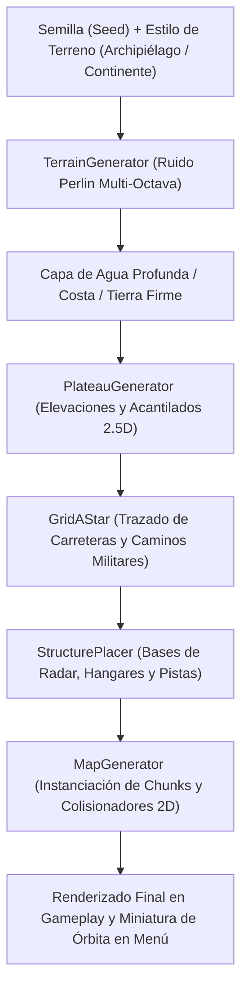

# 📖 MANUAL TÉCNICO Y ARQUITECTÓNICO COMPLETO: PROYECTO AK-47

Este documento constituye la memoria técnica integral de **AK-47**, un videojuego arcade retro de combate aéreo (*Shoot 'Em Up* o *Shmup*) ambientado en una ucronía de la Segunda Guerra Mundial (1944). El título combina generación procedural de mundos, controles táctiles móviles, batallas contra jefes mecánicos, multijugador local y una interfaz inmersiva diegética basada en radios analógicas y herramientas de estado mayor.

---

## 📑 ÍNDICE GENERAL

1. [Visión General y Pilares del Proyecto](#1-visión-general-y-pilares-del-proyecto)
2. [Estructura del Repositorio y Escenas](#2-estructura-del-repositorio-y-escenas)
3. [Flujo Narrativo y Onboarding (Game Flow)](#3-flujo-narrativo-y-onboarding-game-flow)
4. [Motor Procedural de Terreno y Mapas (WorldGen)](#4-motor-procedural-de-terreno-y-mapas-worldgen)
5. [Sistema de Combate y Vuelo (Shmup Core)](#5-sistema-de-combate-y-vuelo-shmup-core)
6. [Jefe de Fase: Tanque Araña (Spider Tank Boss)](#6-jefe-de-fase-tanque-araña-spider-tank-boss)
7. [Multijugador Local (Bluetooth Bridge)](#7-multijugador-local-bluetooth-bridge)
8. [Sistema de Menú Principal y Bottom Navigation](#8-sistema-de-menú-principal-y-bottom-navigation)
9. [Economía, Progresión y Hemeroteca Militar](#9-economía-progresión-y-hemeroteca-militar)
10. [Herramientas de Editor y Mantenimiento](#10-herramientas-de-editor-y-mantenimiento)

---

## 1. VISIÓN GENERAL Y PILARES DEL PROYECTO

### 🎯 La Premisa de Juego
En 1944, cuatro grandes facciones se disputan el dominio del planeta Sixela y sus archipiélagos estratégicos:
- **Anarquistas (Vanguardia Clandestina):** Agilidad extrema, guerra de guerrillas aérea y tecnología de resistencia.
- **Capitalistas (Consorcio Monetario):** Alta industrialización, ametralladoras pesadas y aviones bimotor acorazados.
- **Comunistas (Colectivo Rojo):** Blindaje masivo de acero, potencia de fuego bruta y disciplina colectiva.
- **Fascistas (Doctrina Zenit):** Balística de alta precisión, tecnología de radar avanzada y orden implacable.

### 🕹️ Pilares Técnicos
- **Motor:** Unity 6 (6000.6.0f1) con Universal Render Pipeline (URP 2D).
- **Resolución Objetivo:** 1080 x 1920 (Vertical móvil 9:16).
- **Pipeline de UI:** Unity UI Toolkit (UXML + USS), evitando la sobrecarga de Draw Calls de uGUI tradicional.
- **Física y Control:** Físicas 2D (`Rigidbody2D`) con interpolación para vuelo arcade fluido y sin retardos en dispositivos móviles táctiles.

---

## 2. ESTRUCTURA DEL REPOSITORIO Y ESCENAS

El proyecto está organizado en 10 escenas secuenciales:

| Orden | Nombre de Escena | Propósito / Controlador |
|---|---|---|
| 0 | `0_BrandIntro.unity` | Introducción cinemática del logotipo de la desarrolladora con audio procedural. |
| 1 | `1_FactionSelection.unity` | Selección interactiva de una de las 4 facciones con visualización 3D/2D del caza. |
| 2 | `2_StoryCinematic.unity` | Cinemática de contexto bélico con viñetas ilustradas y texto mecanografiado. |
| 3 | `3_TutorialMission.unity` | Misión jugable de tutorial. Enseña a disparar, esquivar y destruir una batería costera. |
| 4 | `menu.unity` | Menú principal genérico con radio y Bottom Navigation Bar. |
| 5-8| `menu_anarquista.unity`<br>`menu_capitalista.unity`<br>`menu_comunista.unity`<br>`menu_fascista.unity` | Menús principales personalizados con el arte específico de la radio y colores de cada facción. |
| 9 | `gameplay.unity` | Escena de combate real donde se genera el mapa procedural y se combate. |

---

## 3. FLUJO NARRATIVO Y ONBOARDING (GAME FLOW)

Ubicado en [`Assets/Scripts/Flow/`](file:///c:/Users/REIKO/AK_47/Assets/Scripts/Flow/):

### Componentes Clave:
1. **`GameFlowDataStore` ([`FactionPlaneDefinition.cs`](file:///c:/Users/REIKO/AK_47/Assets/Scripts/Flow/FactionPlaneDefinition.cs)):**
   - Controla si el jugador es primerizo (`IsFirstTimeRun()`) o si ya completó el tutorial (`HasCompletedIntroFlow()`).
   - Almacena en `PlayerPrefs` la facción seleccionada (`AK47_SelectedFaction`), el caza activo, y las estadísticas de la sesión.
   - Si el jugador ya completó el tutorial, cualquier inicio de la aplicación lo dirige inmediatamente a `menu.unity` o al menú de su facción.

2. **`BrandIntroToolkitController.cs`:**
   - Gestiona el fundido de entrada y salida del logotipo de marca con efectos de resplandor.

3. **`FactionSelectionToolkitController.cs`:**
   - Permite al jugador deslizar entre las 4 facciones disponibles.
   - Cada facción expone estadísticas de caza (Velocidad, Potencia de Fuego, Resistencia y Habilidad Especial).

4. **`TutorialMissionToolkitController.cs`:**
   - Controla el combate introductorio. Muestra mensajes flotantes estilo telégrafo militar indicando los controles táctiles.
   - Al derrotar al objetivo final del tutorial, ejecuta `CompleteTutorial()` y transiciona suavemente hacia el Menú Principal.

5. **`ProceduralAudio.cs`:**
   - Generador de audio sinfónico y de efectos mediante síntesis de ondas matemáticas en tiempo real (`OnAudioFilterRead`):
     - Ruidos de estática y chasquidos de válvulas analógicas.
     - Clics mecánicos metálicos para diales y botones.
     - Zumbido grave de tubos CRT.
     - Disparos de ametralladora pesada y explosiones de proyectil.

---

## 4. MOTOR PROCEDURAL DE TERRENO Y MAPAS (WORLDGEN)

Ubicado en [`Assets/Scripts/WorldGen/Core/`](file:///c:/Users/REIKO/AK_47/Assets/Scripts/WorldGen/Core/) y [`Assets/Scripts/WorldGen/Generators/`](file:///c:/Users/REIKO/AK_47/Assets/Scripts/WorldGen/Generators/):

AK-47 no utiliza niveles prediseñados estáticos. Cada misión se genera matemáticamente a partir de una semilla numérica (`Seed`):



### 1. `TerrainGenerator.cs`
- Genera matrices de alturas usando múltiples capas de ruido de Perlin (octavas, frecuencia y persistencia).
- Clasifica las baldosas en: Agua profunda, agua costera, arena de playa, llanura verde, bosque espeso y roca.

### 2. `PlateauGenerator.cs`
- Crea mesetas y elevaciones tácticas con bordes de sombra y desniveles, impidiendo que el terreno sea monótono.

### 3. `StructurePlacer.cs` & `StructureData.cs`
- Lee definiciones modulares de estructuras (ScriptableObjects) y analiza el terreno para situar bases militares, baterías antiaéreas y depósitos de combustible en zonas llanas y accesibles.

### 4. `GridAStar.cs`
- Calcula rutas óptimas entre bases militares para dibujar carreteras secundarias y caminos de tierra con curvas suaves.

### 5. Transferencia de Datos de Misión (`MissionDeploymentData.cs`)
- Estructura estática que viaja entre el Menú Principal y `gameplay.unity`:
  - `Seed`: Semilla exacta del mundo.
  - `TerrainStyle`: Continente, Archipiélago, Islas dispersas, etc.
  - `Sector`: Nombre clave militar del sector.
  - `Frequency`: Frecuencia de sintonización de la radio.
  - `TacticalObjective`: Objetivo militar asignado.

---

## 5. SISTEMA DE COMBATE Y VUELO (SHMUP CORE)

Ubicado en [`Assets/Scripts/WorldGen/Shmup/`](file:///c:/Users/REIKO/AK_47/Assets/Scripts/WorldGen/Shmup/):

### 1. `ShmupPlaneController.cs` (Caza del Jugador)
- **Desplazamiento Vertical Continuo:** El avión avanza hacia el norte del mapa a velocidad de crucero constante.
- **Control Lateral:** Admite tanto entrada de teclado/mando (`Input.GetAxis`) como arrastre táctil en pantalla táctil con suavizado inercial (`Vector2.SmoothDamp`).
- **Inclinación de Fuselaje (Banking):** Al girar a la izquierda o derecha, el sprite del caza se rota e intercambia por sprites inclinados simulando aerodinámica tridimensional.
- **Armamento Primario y Secundario:**
  - Cañones automáticos sincronizados con cadencia de tiro adaptable.
  - Lanzamiento de bombas de dispersión para objetivos terrestres.
- **Gestión de Recursos:** Monitoriza puntos de fuselaje (Salud) y depósito de combustible (se consume en vuelo y se recarga al recolectar bidones).

### 2. `ShmupBullet.cs` (Balística y Colisiones)
- Controla la trayectoria, velocidad de boca, penetración de armadura y vida útil de los proyectiles.
- Colisión mediante `OnTriggerEnter2D` diferenciando entre cazas enemigos, tanques de superficie y estructuras militares.

### 3. `ShmupCameraController.cs` & `CinemachineShmupTarget.cs`
- La cámara cenital sigue al avión manteniendo al jugador en el tercio inferior de la pantalla vertical para ofrecer la máxima visibilidad del frente enemigo que se aproxima.

---

## 6. JEFE DE FASE: TANQUE ARAÑA (SPIDER TANK BOSS)

Ubicado en [`Assets/Scripts/WorldGen/Boss/SpiderTankController.cs`](file:///c:/Users/REIKO/AK_47/Assets/Scripts/WorldGen/Boss/SpiderTankController.cs):

Un jefe de fase mecánico colosal que emerge al final de las misiones:
- **Cinemática Inversa Procedural en Patas (IK):** Las patas articuladas calculan sus apoyos sobre el terreno procedural mediante trazado de rayos (*Raycast 2D*), dando la sensación de una máquina todoterreno pesada.
- **Torretas de 360 Grados:** Apuntan activamente hacia la posición del caza del jugador con predicción balística.
- **Fases de Combate:**
  - *Fase 1:* Fuego cruzado de cañones pesados y avance frontal.
  - *Fase 2:* Despliegue de minas de racimo y barreras de balas (*bullet hell*).
  - *Fase 3 (Crítica):* Desprendimiento de blindaje, aumento de velocidad y disparo de rayo concentrado.

---

## 7. MULTIJUGADOR LOCAL (BLUETOOTH BRIDGE)

Ubicado en [`Assets/Scripts/WorldGen/Shmup/Networking/BluetoothMultiplayerBridge.cs`](file:///c:/Users/REIKO/AK_47/Assets/Scripts/WorldGen/Shmup/Networking/BluetoothMultiplayerBridge.cs):

AK-47 incluye una capa de abstracción para juego cooperativo para 2 jugadores en red local Bluetooth:
- **Interfaz `IPlaneInputProvider`:** Desacopla la lógica del avión del hardware de entrada. El avión puede recibir órdenes de un dedo táctil local o de un paquete de red Bluetooth proveniente del segundo jugador.
- **Esquema Maestro/Cliente:** El dispositivo 1 calcula el terreno procedural mediante la semilla compartida y sincroniza las posiciones y proyectiles con el dispositivo 2.

---

## 8. SISTEMA DE MENÚ PRINCIPAL Y BOTTOM NAVIGATION

Ubicado en [`Assets/UI/MainMenu/`](file:///c:/Users/REIKO/AK_47/Assets/UI/MainMenu/):

### Arquitectura de la Pantalla Principal
La pantalla principal está diseñada como una **Bottom Navigation Bar** móvil desacoplada:

```
┌────────────────────────────────────────────────────────────────────────┐
│  BARRA SUPERIOR (top-resource-bar)                                     │
│  [Piloto / Facción]            [🪙 1,250 ORO]       [⛽ 85/100]        │
├────────────────────────────────────────────────────────────────────────┤
│                                                                        │
│  VIEWPORT CENTRAL DE CONTENIDO (content-viewport)                      │
│                                                                        │
│  ┌──────────────────────────────────────────────────────────────────┐  │
│  │ VISTA ACTIVA (100% Pantalla Completa):                           │  │
│  │                                                                  │  │
│  │ 1. [view-misiones]: Radio analógica, visor CRT, diales y radar.  │  │
│  │ 2. [view-periodico]: El Diario Militar con noticias de guerra.   │  │
│  │ 3. [view-hangar]: Taller e inspección de cazas y mejoras.        │  │
│  │ 4. [view-pasaporte]: Carnet de vuelo, telemetría y condecoraciones│ │
│  │ 5. [view-casino]: Ruleta clandestina y Mercado Negro.            │  │
│  └──────────────────────────────────────────────────────────────────┘  │
│                                                                        │
├────────────────────────────────────────────────────────────────────────┤
│  TOOLBAR INFERIOR FIJA (bottom-navigation-bar)                         │
│  [CASINO]    [DIARIO]       ★ [MISIÓN] ★       [HANGAR]    [PERFIL]    │
└────────────────────────────────────────────────────────────────────────┘
```

### Comportamiento del Controlador (`MainMenuController.cs`)
- **Desacoplamiento Total:** Al pulsar una pestaña (ej: **DIARIO**), la radio analógica al completo se oculta (`display: none`) y la vista elegida se muestra a pantalla completa (`display: flex`).
- **Botón Central Elevado:** El botón de **MISIÓN** está sobredimensionado y resaltado en el centro de la barra inferior con iluminación ámbar/verde.
- **Diales Giratorios Interactivos:**
  - `btn-maindial` (Dial Derecho): Cambia entre emisoras de radio y cuadrículas de sectores en intervalos 3x3 (86.0 MHz, 89.0 MHz, 92.0 MHz...).
  - `btn-subdial` (Dial Izquierdo): Conmuta entre los 4 estados de la señal (*Alerta Temprana, Patrulla, Asalto, Retaguardia*) rotando suavemente el sprite del dial con física auditiva de trinquete (*ratchet sound*).

---

## 9. ECONOMÍA, PROGRESIÓN Y HEMEROTECA MILITAR

### 💰 Economía del Jugador
Gestionada mediante métodos encapsulados con persistencia directa en `PlayerPrefs`:
- **Oro Militar (`AK47_PlayerGold`):** Se gana completando misiones y derribando escuadras enemigas. Se gasta en mejoras de taller o tiradas en la ruleta.
- **Combustible (`AK47_PlayerFuel`):** Energía necesaria para despegar en misiones. Se recupera con el tiempo o comprando bidones en el mercado negro.
- **Gemas de Oficial (`AK47_PlayerGems`):** Moneda especial para desbloquear cazas raros o licencias militares avanzadas.

### 📰 Hemeroteca Militar (`HemerotecaManager.cs`)
Un sistema narrativo dinámico que conecta las partidas de combate con la prensa de la época:
- Cada vez que una misión termina en `gameplay.unity`, se llama a `HemerotecaManager.RecordMission(...)`.
- El sistema genera una crónica periodística contextual con:
  - Titular propagandístico de guerra (*¡VICTORIA EN EL ESTUARIO: 16 CAZAS DERRIBADOS!*).
  - Bajas enemigas y aliadas, porcentaje de puntería y estado de los refugios civiles.
  - Fecha de 1944 y sello militar `CLASIFICADO // ESTADO MAYOR`.
  - Anuncios de época de talleres de aviación y combustible.
- Al entrar en el menú **DIARIO**, el controlador selecciona crónicas aleatorias y permite pasar páginas de expedientes anteriores.

---

## 10. HERRAMIENTAS DE EDITOR Y MANTENIMIENTO

El proyecto cuenta con utilidades en carpetas `Editor/` para facilitar el trabajo del desarrollador en Unity:
1. **`ForceRefreshUXML.cs`:**
   - Detecta cambios en los archivos UXML/USS e invoca `AssetDatabase.ImportAsset` en segundo plano.
   - Proporciona el menú superior de acceso directo: **`AK47 > Forzar Reimportación Menú UXML`**.
2. **`ResetGameFlowProgress.cs`:**
   - Menú de depuración para reiniciar el progreso de tutorial y `PlayerPrefs`, permitiendo volver a probar la experiencia de primer inicio.
3. **`MapGeneratorEditor.cs` & `WfcVisualStudioWindow.cs`:**
   - Permite previsualizar la generación procedural de mundos dentro de la ventana de escena de Unity sin necesidad de entrar en modo Play.

---

*Documento consolidado para el equipo de desarrollo de **AK-47**. Todos los módulos se encuentran verificados y operativos.*
